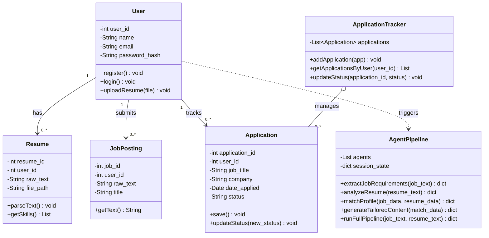
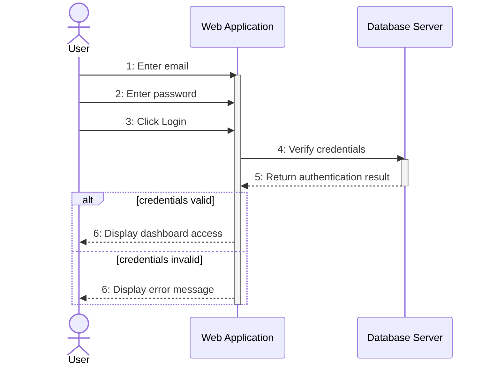
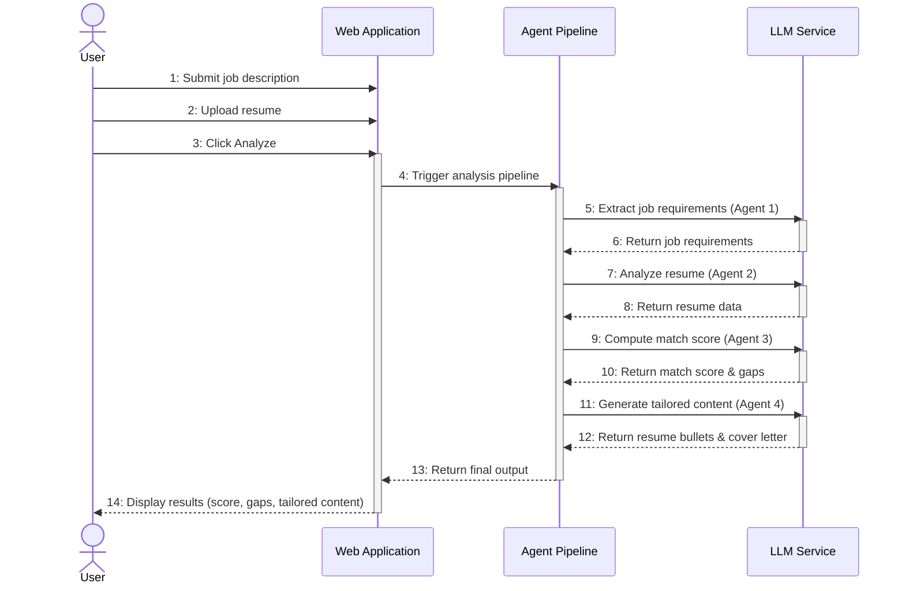

# Class_and_Sequence_Diagram_Of_AutoApply

**Assignment | Software Engineering Laboratory (CSE-3206)**
Bangladesh University of Professionals, Department of Computer Science and Engineering
Session: July-December 2026 | Date of Submission: 24/09/2026

---

## Submission Details

**Submitted to**

| Name | Designation | Institution |
|---|---|---|
| Tanjim Taharat Aurpa | Assistant Professor, Department of Data Science and Engineering | University of Frontier Technology, Bangladesh |
| Rumana Yasmin | Lecturer, Department of Computer Science and Engineering | Bangladesh University of Professionals, Mirpur Cantonment, Dhaka-1216 |

**Submitted by**

| Sl | Class Roll | Name |
|---|---|---|
| 01 | 24524203065 | Ahmad Ibrahim Nahian |
| 02 | 24524203179 | Mahathir Mohammad |
| 03 | 23524202003 | MD. Hasibul Hasan Talukdar |
| 04 | 24524203135 | MD. Akimo Islam Sad |

---

## What This PDF Contains

File: `Class_and_Sequence_Diagram_Of_AutoApply.pdf` (4 pages)

| Page | Content |
|---|---|
| 1 | Cover page (course details, supervisors, group members) |
| 2 | **Class Diagram** of AutoApply |
| 3 | **Sequence Diagram 1:** User Login |
| 4 | **Sequence Diagram 2:** Analysis Pipeline |

Only two operations are modeled as sequence diagrams, as the assignment requires. They were chosen to show both a simple conditional flow (login) and the core operation of the system (analysis pipeline).

---

## 1. Class Diagram (Page 2)

The diagram has **6 classes** and **5 relationships**.

### Classes

| Class | Purpose | Key members |
|---|---|---|
| `User` | The registered student / job seeker | `user_id`, `name`, `email`, `password_hash`; `register()`, `login()`, `uploadResume(file)` |
| `Resume` | The uploaded resume and its extracted text | `resume_id`, `user_id`, `raw_text`, `file_path`; `parseText()`, `getSkills()` |
| `JobPosting` | The pasted job description | `job_id`, `user_id`, `raw_text`, `title`; `getText()` |
| `AgentPipeline` | Runs the four analysis steps in order | `agents`, `session_state`; `extractJobRequirements()`, `analyzeResume()`, `matchProfile()`, `generateTailoredContent()`, `runFullPipeline()` |
| `Application` | One saved job application | `application_id`, `user_id`, `job_title`, `company`, `date_applied`, `status`; `save()`, `updateStatus()` |
| `ApplicationTracker` | Manages the collection of applications | `applications`; `addApplication()`, `getApplicationsByUser()`, `updateStatus()` |

Notation: `-` private, `+` public.

### Relationships

| From | To | Label | Type | Multiplicity | Line style |
|---|---|---|---|---|---|
| `User` | `Resume` | has | Association | 1 to 0..* | Solid |
| `User` | `JobPosting` | submits | Association | 1 to 0..* | Solid |
| `User` | `Application` | tracks | Association | 1 to 0..* | Solid |
| `User` | `AgentPipeline` | triggers | Dependency | none | Dashed |
| `ApplicationTracker` | `Application` | manages | Aggregation | 0..* | Solid, hollow diamond |

**Why these types**
- **Association (solid):** `User` permanently owns its resumes, job postings and applications.
- **Dependency (dashed):** `User` only calls `AgentPipeline` when analyzing. It does not keep it as an attribute.
- **Aggregation (hollow diamond):** `Application` records can exist without the tracker, which only organizes them.

---

## 2. Sequence Diagram 1: User Login (Page 3)

**Lifelines:** User, Web Application, Database Server

| Step | Message |
|---|---|
| 1 | User enters email |
| 2 | User enters password |
| 3 | User clicks Login |
| 4 | Web Application sends "Verify credentials" to Database Server |
| 5 | Database Server returns authentication result (dashed return) |
| 6 | Web Application replies to User (see `alt` below) |

**`alt` fragment (if / else):**
- `[credentials valid]`: display dashboard access
- `[credentials invalid]`: display error message

Only one branch runs, depending on the authentication result.

---

## 3. Sequence Diagram 2: Analysis Pipeline (Page 4)

**Lifelines:** User, Web Application, Agent Pipeline, LLM Service

| Step | Message |
|---|---|
| 1-2 | User submits job description and uploads resume |
| 3 | User clicks Analyze |
| 4 | Web Application triggers the analysis pipeline |
| 5-6 | Agent 1: extract job requirements, LLM returns job requirements |
| 7-8 | Agent 2: analyze resume, LLM returns resume data |
| 9-10 | Agent 3: compute match score, LLM returns score and gaps |
| 11-12 | Agent 4: generate tailored content, LLM returns resume bullets and cover letter |
| 13 | Agent Pipeline returns final output to Web Application |
| 14 | Web Application displays score, gaps and tailored content to User |

The four agent calls run one after another. Each call is a solid arrow to the LLM Service, answered by a dashed return.

---

## Notation Used

| Element | Meaning |
|---|---|
| Lifeline | A participant, with a dashed vertical line below it |
| Solid arrow | Message sent (call) |
| Dashed arrow | Return message |
| Activation bar | Period during which a lifeline is active |
| `alt` box | Alternative paths (if / else) |
| Numbered messages | Order of messages from top to bottom |

---

## Other Sequence Diagrams (Not Included in This PDF)

These operations are not drawn in this submission. They can be modeled with the same lifelines and the same class diagram if needed.

| Operation | Main participants |
|---|---|
| Register | User, Web Application, Database Server |
| Upload Resume | User, Web Application, Database Server |
| Save Application to Tracker | User, Web Application, Database Server |
| Update Application Status | User, Web Application, Database Server |
| View Application Tracker | User, Web Application, Database Server |

---

## Diagram Source (Mermaid)

Both diagrams were written in [Mermaid](https://mermaid.js.org/). The code below renders on GitHub or at [mermaid.live](https://mermaid.live).

Class Diagram

Sequence Diagram 1: User Login

Sequence Diagram 2: Analysis Pipeline

